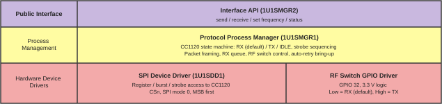

# Capstone: ESP32 ↔ CC1120 firmware

Microcontroller code for controlling a TI CC1120 dev board (420–470 MHz).
It runs on an ELEGOO ESP32 dev board (ESP32-WROOM-32) using ESP-IDF, which includes FreeRTOS. The code is written in C++.

The radio sits in **receive mode by default** and returns to RX after every transmit, so a unit with no console (the remote unit) boots straight into listening. For bench work, an optional serial command console over USB lets you read and write registers, send command strobes, check chip status, set the frequency, and send/receive packets.

## Software architecture



| Layer | ID | Code |
|---|---|---|
| Interface API | 1U1SMGR2 | [src/api/](src/api/) `api::RadioApi`: `send`, `receive`, `setFrequency`, `status` |
| Protocol Process Manager | 1U1SMGR1 | [src/protocol/](src/protocol/) `protocol::ProcessManager`: state machine, packet framing, RX task, RF switch control |
| SPI Device Driver | 1U1SDD1 | [src/cc1120/](src/cc1120/) `cc1120::Cc1120` |
| RF Switch GPIO Driver | | [src/rfswitch/](src/rfswitch/) |

Each layer only calls the one below it. The debug console is a client of the Interface API (plus raw driver access for register debugging, which can disturb the Protocol Manager's state).

## Hardware wiring

The ESP32 column below is the GPIO number printed on the Elegoo board's
silkscreen. The CC1120 column uses the signal labels printed on the CC1120
board; GPIO1 is also the SPI `SO`/`CHIP_RDYn` signal.

| CC1120 board silk label | ESP32 board silk label | Notes |
|---|---|---|
| SCLK | 18 | VSPI clock |
| SO / GPIO1 | 19 | VSPI MISO; also CHIP_RDYn |
| SI | 23 | VSPI MOSI |
| CSn | 5 | Driven manually by the driver |
| RESET_N | 4 | |
| GPIO0 | 26 | Reserved for interrupts in Phase 2 |
| GPIO2 | 27 | Reserved for interrupts in Phase 2 |
| GPIO3 | 25 | Reserved |
| (RF switch select) | 32 | 3.3 V logic to the external RF switch: **Low = RX (default), High = TX** |
| VDD | External | Driven by other power sources |
| GND | GND | |

All pin assignments are in [src/config/pins.h](src/config/pins.h).

## Building and flashing

In order to connect to the ESP32 using the onboard USB-C to UART bridge, you will need to install the CP210x USB driver for your operating system. You can find the drivers here: [https://www.silabs.com/developers/usb-to-uart-bridge-vcp-drivers](https://www.silabs.com/developers/usb-to-uart-bridge-vcp-drivers).

You need VS Code with the PlatformIO extension. The first build downloads the ESP-IDF toolchain automatically. It can be found here: [https://marketplace.visualstudio.com/items?itemName=platformio.platformio-ide](https://marketplace.visualstudio.com/items?itemName=platformio.platformio-ide)

```sh
pio run                    # build
pio run -t upload          # flash (board connected over USB)
pio run -e remote          # remote-unit build: no serial console
pio device monitor         # serial console, 115200 baud
```

You can also use the PlatformIO toolbar buttons for Build, Upload and Monitor.

## Console commands

Type `help` at the `cc1120>` prompt to list all commands.

| Command | Description |
|---|---|
| `id` | Read PARTNUMBER (CC1120 = `0x48`) and PARTVERSION |
| `status` | Show the status byte (CHIP_RDYn and state), MARCSTATE, and RX/TX FIFO byte counts |
| `reset [hard\|soft]` | `hard` pulses RESET_N; `soft` sends the SRES strobe |
| `strobe <name\|hex>` | Send a command strobe: `SRES SFSTXON SXOFF SCAL SRX STX SIDLE SAFC SWOR SPWD SFRX SFTX SWORRST SNOP` |
| `rd <addr> [count]` | Read registers, e.g. `rd 0x0C`, `rd 0x2F8F`, or `rd 0x2F0C 3` |
| `wr <addr> <value>` | Write a register, e.g. `wr 0x04 0xAB` |
| `dump` | Dump all configuration registers (normal and extended) |
| `preset` | Load the default 434 MHz, 1.2 kbps 2-FSK configuration and calibrate |
| `freq [MHz]` | Get the carrier frequency, or set it (410–480 MHz) and recalibrate |
| `send <text>` | Transmit a packet (max 127 bytes), then return to RX |
| `recv [ms]` | Wait for a received packet and print it as hex |

Addresses `0x00`–`0x2E` are normal registers. Extended registers are written as `0x2Fxx`.

### Quick hardware check

```
cc1120> id            -> PARTNUMBER 0x48 (CC1120)
cc1120> status        -> state=IDLE
cc1120> wr 0x04 0xAB
cc1120> rd 0x04       -> 0x0004: AB
cc1120> preset
cc1120> freq          -> 434.0000 MHz
cc1120> strobe SRX
cc1120> status        -> state=RX
cc1120> strobe SIDLE
```

If `PARTNUMBER` is `0xFF`, the CC1120 is not driving SO/MISO. Check that the radio is powered
at the voltage required by the board, shares ground with the ESP32, and that CSn, RESET_N,
and SO/MISO are wired to the pins above. `ESP_ERR_TIMEOUT` means SO stayed high while CSn
was asserted, which usually indicates the same wiring or power problem.

## Project layout

```
platformio.ini, CMakeLists.txt, sdkconfig.defaults   build configuration
src/main.cpp                    app_main: starts the Protocol Manager (and console if enabled)
src/api/radio_api.h/.cpp        Interface API (1U1SMGR2)
src/protocol/protocol_manager.* Protocol Process Manager (1U1SMGR1)
src/rfswitch/rfswitch.h/.cpp    RF switch GPIO driver (GPIO 32)
src/Kconfig.projbuild           RADIO_ENABLE_CONSOLE option (off in the remote env)
src/config/pins.h               pin map
src/cc1120/cc1120.h/.cpp        SPI driver (mutex-protected, FreeRTOS-safe)
src/cc1120/cc1120_regs.h        register map, strobes, status fields
src/cc1120/cc1120_presets.h     default 434 MHz register preset
src/console/console.h/.cpp      optional esp_console debug commands
Datasheets/cc1120.pdf           CC1120 datasheet
```

> The default preset is adapted from TI's EasyLink example settings. Regenerate it with **SmartRF Studio 7** for your exact board, crystal and data rate.
